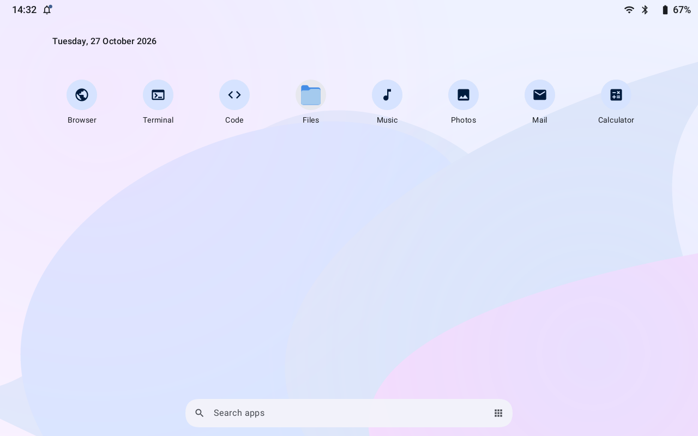
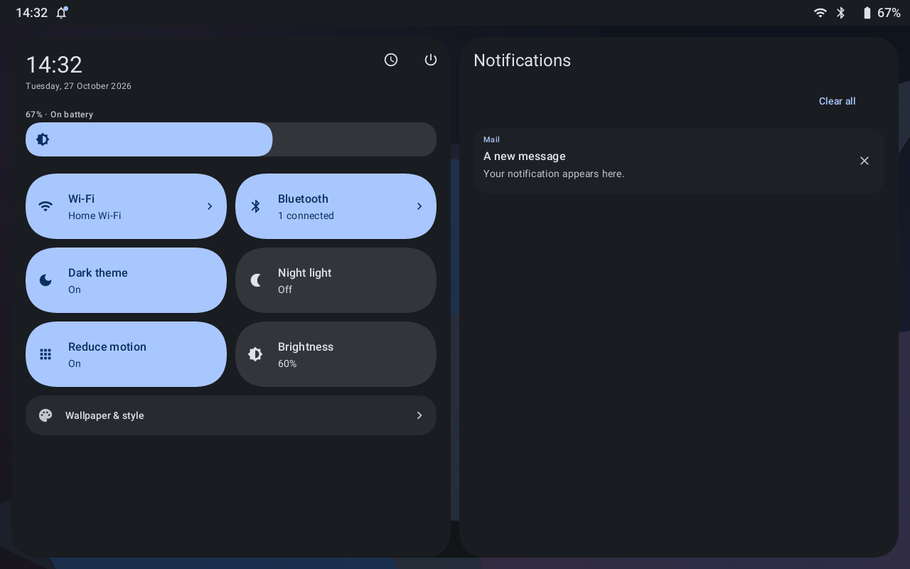
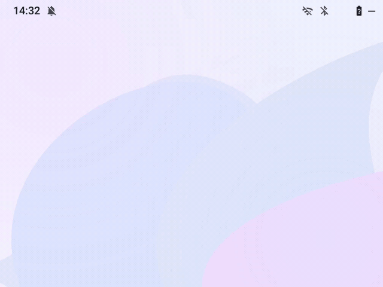

# MateriaLand

An Android-inspired Wayland desktop for Linux, built with Rust and Smithay.
Material You colors, rounded panels, and spring motion — on your desktop.

[What's new in 0.6.0](docs/RELEASE_NOTES.md) · [Install](docs/INSTALLATION.md) · [Controls](docs/USAGE.md) · [Configure](docs/CONFIGURATION.md)

| A home screen you arrange | Quick settings, light or dark |
| :---: | :---: |
|  |  |

*Previews rendered by the shell with sample apps and service data; not live-session screenshots.*

- **Make it yours.** Place shortcuts freely, keep empty spaces, and choose your palette.
- **Move between apps.** Search the app drawer, browse recent windows, or pair two apps in split screen.
- **Keep controls close.** Notifications, Wi-Fi, Bluetooth, brightness, and appearance in one shade.

<details>
<summary><strong>See the spring motion</strong> — open, rebound, and reverse</summary>

<p align="center">
  
</p>

Synthetic animation preview using the shell's spring and painter. Reduce motion disables the rebound.

</details>

## Try it

Install Rust and the [native build dependencies](docs/INSTALLATION.md#build-and-run), then run:

```sh
cargo build --release --locked
./target/release/materialand --nested
```

For a standalone desktop session, follow the [SDDM or TTY setup](docs/INSTALLATION.md).

| Start here | Shortcut |
| --- | --- |
| Home | `Super` |
| App drawer | `Super+P` |
| Recent apps | `Super+Tab` |
| System shade | `Super+S` |

[All shortcuts and touchpad gestures →](docs/USAGE.md)

## Status and documentation

Experimental: native Wayland apps, one output at scale 1. XWayland and multi-monitor
layouts are not implemented. Hardware brightness, Night light, and touchpad gestures
require a direct session and compatible hardware.

[Appearance & motion](docs/DESIGN.md) · [System controls](docs/SYSTEM_CONTROLS.md) · [Architecture](docs/ARCHITECTURE.md) · [Validation](docs/VALIDATION.md)
