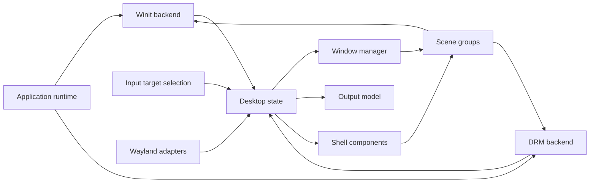

# Ownership and rendering contracts

## Windows and coordinates

`WindowManager` owns the mapped Smithay space, registered window metadata/properties, focus and resize transactions. Creating an XDG toplevel registers a window; the initial empty commit triggers configuration. Its first committed buffer maps and focuses it. Committing a null buffer unmaps it. A minimized window remains registered while absent from the mapped space.

`SurfaceSpace` is the coordinate authority. A window location refers to its XDG geometry, while the surface origin is that location minus the geometry offset inside the client buffer. Rendering and hit testing use the same origin. Surface-tree hit offsets are added to the global origin before delivery to Smithay. Popup surfaces are hit-tested without first clipping to their parent's geometry.

Input selects one target in scene order: shell overlays/chrome, a client surface, a decoration, or the desktop. Scroll shares this selection. Client grabs retain additional button events. Consumed button/key presses are paired with consumed releases; physical keycodes identify swallowed keys even when modifiers/layouts change. Seat suspension cancels grabs and releases tracked input state.

Resize requests configure a size while retaining the committed window placement. A `ResizePlacement` moves an anchored edge only after the client acknowledges and commits the requested state. Position calculations use the client's actual geometry and respect its size limits.

## Scene and outputs

`Layers` accepts groups in back-to-front order. Each group is already front-to-back. Final assembly reverses groups, never the surface elements inside an individual window. Decorations sit behind the complete client surface tree within the same window group. Popup/subsurface order therefore survives composition of overlapping windows.

Window entrances uniformly transform the entire surface/decorations group on the GPU while clients retain their native protocol size. The origin is the launch icon when a matching launch is pending, otherwise the window center. Entrance time starts after its first frame is presented. A focused launching window is composited above the outgoing launcher; panels and menus stay in front. Clicks on the moving frame finish the entrance and are consumed so controls at invisible final coordinates cannot activate. Once settled, surface coordinates and normal input delivery apply directly. Client cursor surfaces retain their own buffer scale and hotspot; named cursors have a raster fallback.

The output model describes an upright, scale-1 logical desktop. Winit's framebuffer orientation is handled by its own damage tracker, independently of protocol output metadata. DRM gets the connector's physical mode and millihertz refresh. `set_output_mode` updates output metadata, desktop size, pointer bounds and maximized/fullscreen placement together.

DMA-BUF import requests are completed only after the active renderer validates the buffer. A changed GPU format set replaces the advertised global while preserving disabled old globals for existing clients.

## Direct-session lifetime

The DRM backend owns the seat, libinput/udev sources, pending GPU initialization and the active output. Input source registration succeeds as a unit. Pause removes timers/device sources and drops scanout; resume rebuilds renderer/output state from the seat. Connector-change events keep an unchanged output alive and recreate it when the selected connector/mode changes.

`FrameState` permits one submitted frame. Rendering synchronizes its fence, queues once, and waits for vblank before acknowledging scanout and releasing client frame callbacks. A no-damage frame may release callbacks for content already presented. Scheduling coalesces redraw requests and derives its animation budget from the output refresh; idle wakeups maintain the clock.

The listening socket, output and GPU are separate resources. Dropping/reopening a GPU preserves Wayland clients and desktop state. A private session bus has the compositor process lifetime and isolates normal D-Bus activation from a parent desktop.

Light/dark mode and palette choices are loaded before the first frame and saved together on every change. Environment settings supply initial defaults; saved choices take priority. Appearance, dock pins and home shortcuts share atomic file replacement under the XDG configuration directory.

## Boundaries retained from the original implementation

Smithay continues to own protocol validation, buffer/surface-tree handling, keyboard state and low-level device APIs. Material color computation, raster drawing and widget appearance were split into dedicated components rather than replaced with another graphics toolkit. Existing visual and utility tests were retained alongside new contract tests.
